<div align="center">


# SaldoPlan

### Sua vida financeira, organizada em um só lugar.

**Controle financeiro · Planejamento · Mercado · Sincronização entre dispositivos**

[](https://saldoplan.vercel.app/)
[](https://saldoplan.vercel.app/)
[](https://developer.mozilla.org/pt-BR/docs/Web/JavaScript)
[](https://firebase.google.com/)
[](https://vercel.com/)

[**Acessar o SaldoPlan**](https://saldoplan.vercel.app/) · [**Conhecer o projeto**](https://joeyrickson-portfolio.vercel.app/) · [**Reportar problema**](https://github.com/JoeyRickson/PWA_CAIXA/issues)

<br/>

<a href="screenshots/resumo.png">
  
</a>

*Prévia do painel financeiro — clique para ampliar.*

</div>

---

## Sobre o projeto

O **SaldoPlan** é um aplicativo independente de organização e planejamento financeiro pessoal, desenvolvido como uma **Progressive Web App (PWA)**. Funciona no computador e no celular, pode ser instalado pelo navegador e mantém recursos locais disponíveis mesmo sem conexão, conforme o conteúdo previamente carregado.

O objetivo é reunir em uma interface simples o acompanhamento de receitas, despesas, compromissos, cartões, metas, patrimônio, folha salarial e indicadores econômicos. O projeto utiliza **HTML, CSS e JavaScript puro**, sem um framework de interface principal.

## Funcionalidades

| Área | O que você encontra |
| :--- | :--- |
| **Resumo financeiro** | Visão geral de receitas, despesas, saldos e compromissos, com distinção entre valores previstos e realizados. |
| **Lançamentos** | Receitas, despesas, categorias, recorrências e edição de registros. |
| **Cartões e faturas** | Fechamento, vencimento, limites e compras parceladas. |
| **Guardado e metas** | Aportes, retiradas, objetivos e acompanhamento de valores reservados. |
| **Planejamento** | Projeção de 30, 60 e 90 dias, calendário de vencimentos, simulação de parcelas e conferência manual de saldos. |
| **Patrimônio** | Registro de investimentos, bens, dívidas e evolução patrimonial. |
| **Folha e benefícios** | Simulação de salário, horas extras, adicional noturno, 13º salário, conferência de contracheque e FGTS por empregador. |
| **Importação** | Importação de extratos compatíveis, com prévia e conferência dos lançamentos. |
| **Mercado** | Selic, dólar, IPCA, gráficos históricos, títulos do Tesouro e comparação educativa de renda fixa. |
| **Notícias econômicas** | Calendário por dia e mês, busca, filtros, fonte, data, links originais e imagens quando a fonte disponibiliza. |
| **Dados e backup** | Exportação, histórico de versões, backup opcional e sincronização por conta Google quando configurada. |

## Conheça as telas

<div align="center">

<table>
<tr>
<td width="50%" align="center"><b>Mercado e indicadores</b><br/><a href="screenshots/mercado.png">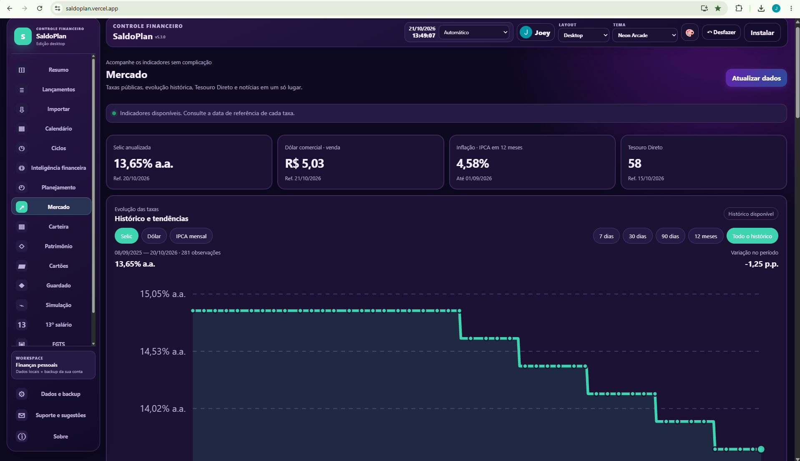</a></td>
<td width="50%" align="center"><b>Planejamento financeiro</b><br/><a href="screenshots/planejamento.png">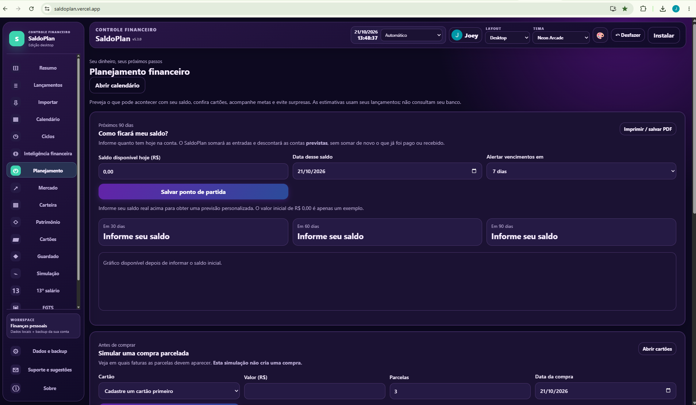</a></td>
</tr>
<tr>
<td align="center"><b>Lançamentos</b><br/><a href="screenshots/lancamentos.png">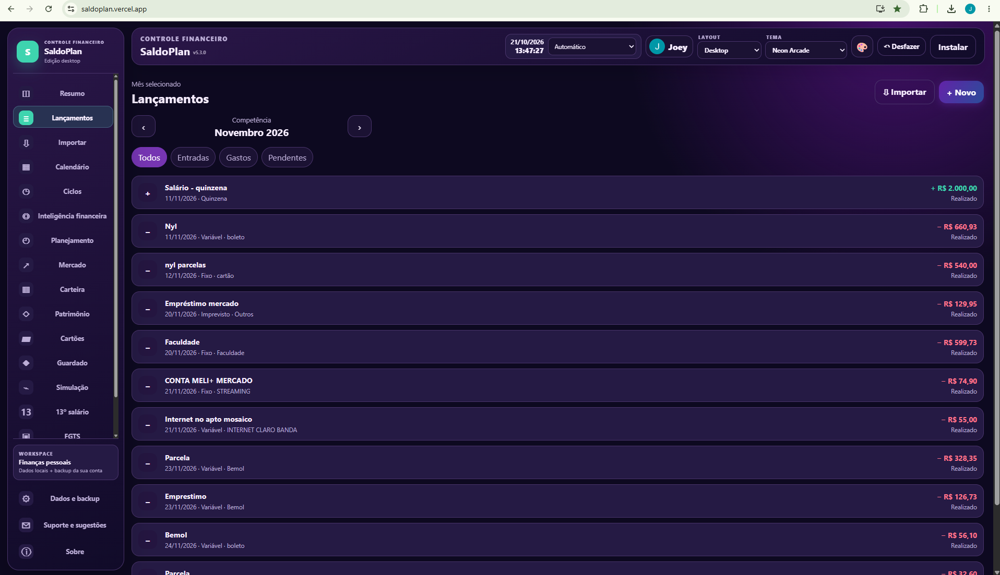</a></td>
<td align="center"><b>Cartões e faturas</b><br/><a href="screenshots/cartoes.png">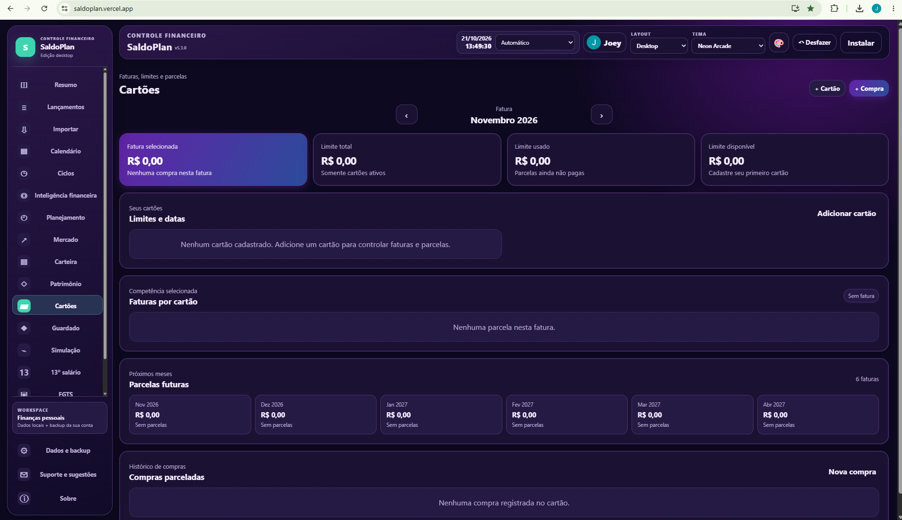</a></td>
</tr>
<tr>
<td align="center"><b>Valores guardados</b><br/><a href="screenshots/guardado.png"></a></td>
<td align="center"><b>Patrimônio</b><br/><a href="screenshots/patrimonio.png">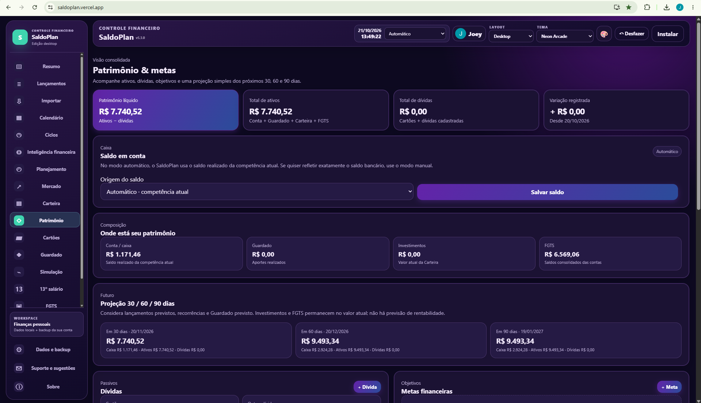</a></td>
</tr>
</table>

</div>

<details>
<summary><strong>Ver mais capturas de tela</strong></summary>

| Tela | Captura |
| :--- | :--- |
| Inteligência financeira | 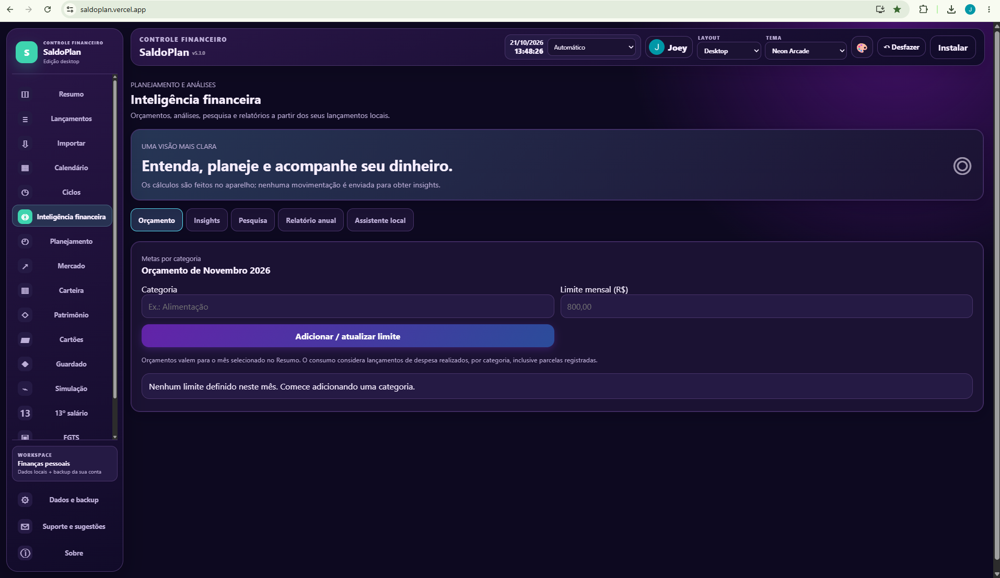 |
| Simulação de folha | 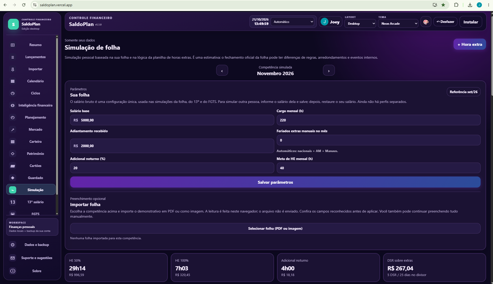 |
| 13º salário | 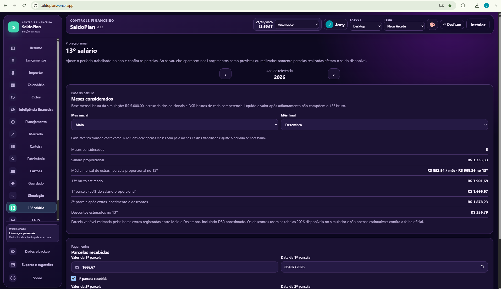 |
| FGTS por empresa | 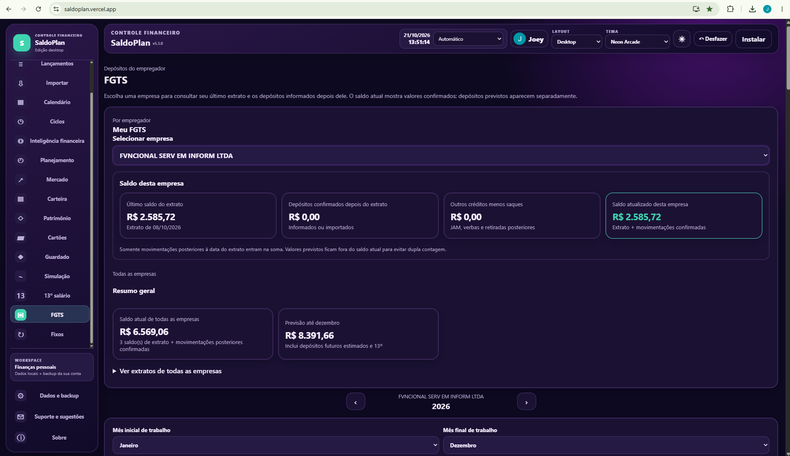 |
| Despesas fixas | 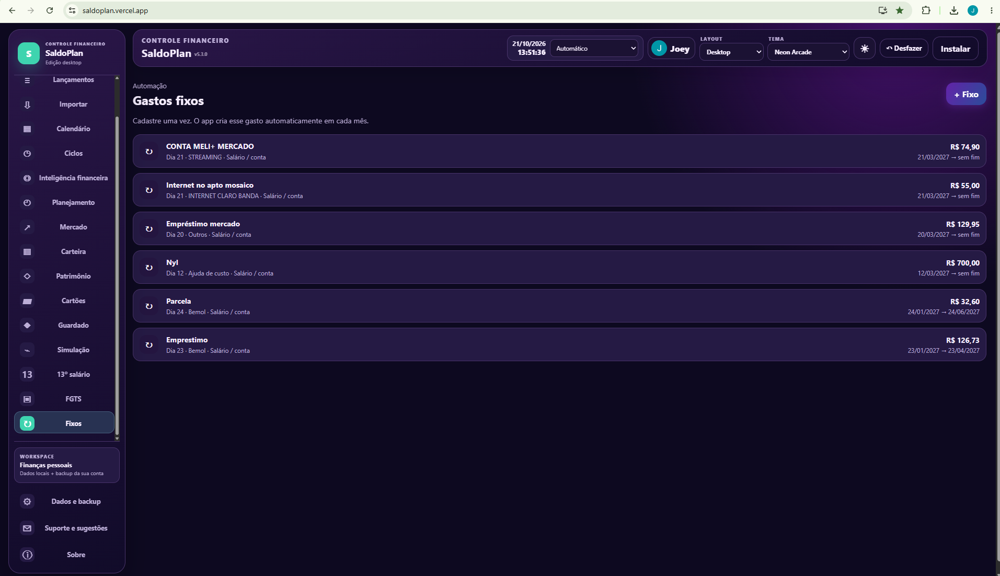 |
| Importação de extratos | 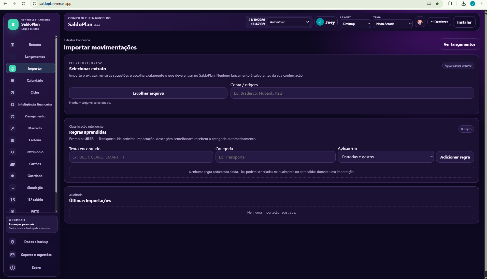 |
| Ciclos financeiros | 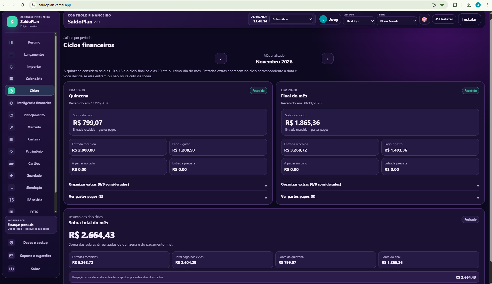 |
| Carteira financeira | 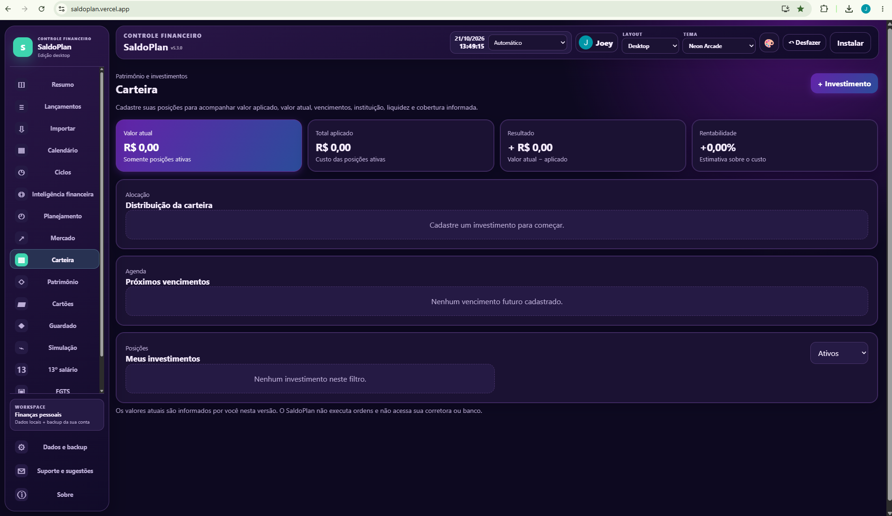 |

</details>

> As imagens mostram a interface do aplicativo em desenvolvimento. A disponibilidade de integrações externas depende da configuração de cada ambiente.

## Destaques da versão 5.3.4

### Mercado reformulado

- **Indicadores oficiais:** Selic anualizada, dólar comercial e inflação, sempre com data de referência.
- **Gráficos históricos:** consulta por período e visualização das variações com periodicidade adequada ao indicador.
- **Tesouro Direto:** títulos, vencimentos e taxas disponíveis nas fontes públicas, com filtros de navegação.
- **Notícias econômicas:** calendário por mês e dia, pesquisa e filtros por assunto, data e fonte.
- **Fotos e links:** aproveitamento de imagens do RSS ou de metadados da matéria original em fontes permitidas, quando disponíveis.
- **Resiliência:** mensagens de indisponibilidade e reaproveitamento controlado de dados consultados anteriormente.

**Limitações:** o histórico jornalístico depende da cobertura das fontes e não é exaustivo; nem toda notícia fornece fotografia. Cotações e títulos exibidos são informativos e podem não representar valores negociáveis em tempo real. O comparador de renda fixa é uma estimativa educativa e não garante rentabilidade.

### Planejamento integrado

O painel de Planejamento reúne previsão financeira de **30, 60 e 90 dias**, compromissos futuros, simulação de compras parceladas, metas e conferência **manual** de saldos bancários. Não realiza conexão automática Open Finance.

### Live Sync e proteção dos dados

Com a sincronização opcional ativa, o login Google vincula o perfil à conta e permite atualizar registros entre celular e computador por meio do Firestore, inclusive propagando exclusões. Alterações offline são encaminhadas quando possível, e conflitos exigem tratamento seguro.

O **Live Sync não é criptografia ponta a ponta**. Ele é diferente do backup criptografado e não substitui uma cópia de segurança independente. Dados locais divergentes não devem ser sobrescritos automaticamente.

## Tecnologias

- **Frontend:** HTML5, CSS3 e JavaScript vanilla.
- **PWA:** Service Worker, cache de arquivos estáticos e instalação pelo navegador.
- **Autenticação:** Firebase Authentication (Google).
- **Sincronização opcional:** Cloud Firestore com regras de acesso por usuário.
- **Backend:** Node.js e Vercel Serverless Functions.
- **Fontes públicas:** Banco Central (SGS), Tesouro Direto e feeds de notícias.
- **Backups:** exportação local e opções de cópia em nuvem conforme configuração.

## Executar localmente

Requer **Node.js** e um ambiente configurado para as funções serverless.

```powershell
# Clone o repositório e entre na pasta
npm.cmd ci

# Para executar a PWA incluindo /api/*
npx.cmd vercel dev --listen 3000
```

Acesse `http://localhost:3000` depois que o servidor indicar que está pronto. Na primeira configuração, vincule a pasta ao **seu próprio projeto Vercel** e configure as variáveis necessárias sem compartilhá-las.

> Servidores estáticos como `http-server` servem para conferir a interface, mas **não executam** as funções em `/api/*`. Por isso, não validam integralmente o Mercado nem o suporte administrativo.

### Testes e verificações

```powershell
npm.cmd test
npm.cmd audit --omit=dev
node --check .\app.js
git diff --check
git status --short
```

### Segurança

Nunca inclua no repositório `node_modules/`, `.vercel/`, `.env.local`, chaves privadas, backups pessoais ou dados financeiros. As credenciais de backend devem permanecer exclusivamente nas variáveis de ambiente adequadas. Não é necessário limpar `localStorage` ou IndexedDB para atualizar a interface.

## Documentação

- [Arquitetura do aplicativo](ARQUITETURA.md)
- [Histórico de versões](CHANGELOG.md)
- [Mercado — versão 5.3.4](MERCADO-5.3.4.md)
- [Mercado — versão 5.3.3](MERCADO-5.3.3.md)
- [Planejamento — versão 5.3.0](PLANEJAMENTO-5.3.0.md)
- [Live Sync](LIVE-SYNC-SETUP.md)
- [Conferência de contracheque](CONFERENCIA-FOLHA.md)
- [FGTS por empregador](FGTS-EMPRESAS.md)
- [Configuração do Firestore](FIRESTORE-SETUP.md)

## Evolução recente

| Versão | Principal entrega |
| :--- | :--- |
| **5.3.4** | Imagens reais quando disponíveis, melhores metadados e apresentação dos cartões de notícias. |
| **5.3.3** | Calendário e histórico consultável de notícias econômicas. |
| **5.3.2** | Correção das consultas SGS, gráficos históricos e navegação do Tesouro. |
| **5.3.1** | Nova interface do Mercado e organização das fontes públicas. |
| **5.3.0** | Planejamento financeiro integrado. |
| **5.2.1** | FGTS organizado por empregador. |
| **5.2.0** | Conferência detalhada de contracheques. |
| **5.1.x** | Live Sync e melhorias na vinculação automática de dispositivos. |

O histórico completo permanece em [CHANGELOG.md](CHANGELOG.md).

## Autor

Desenvolvido e mantido por **Joey Rickson**.

[GitHub](https://github.com/JoeyRickson) · [LinkedIn](https://linkedin.com/in/joeyrickgoliveira) · [Portfólio](https://joeyrickson-portfolio.vercel.app/)

---

<div align="center">

**Tecnologia para resolver problemas reais.**

*O SaldoPlan é um projeto independente de organização financeira e não presta consultoria de investimentos.*

</div>
