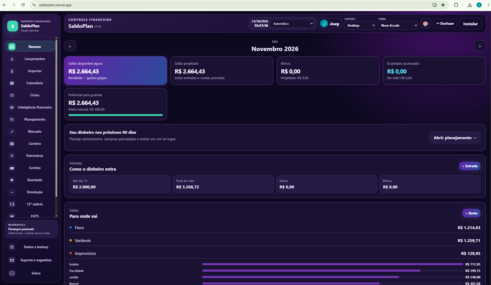
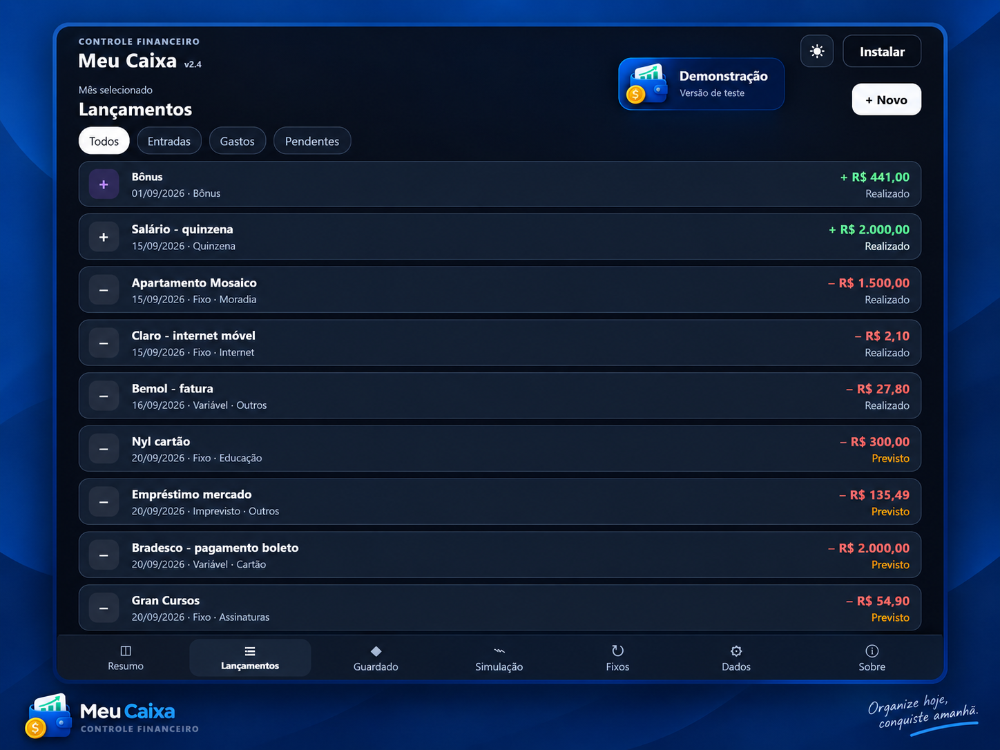
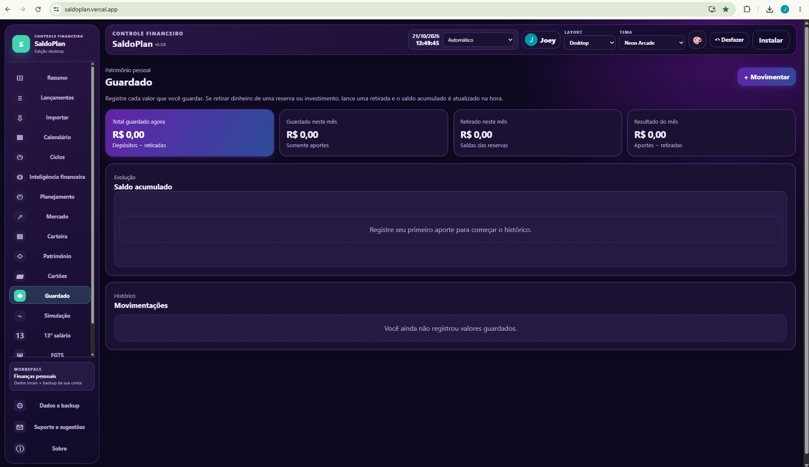
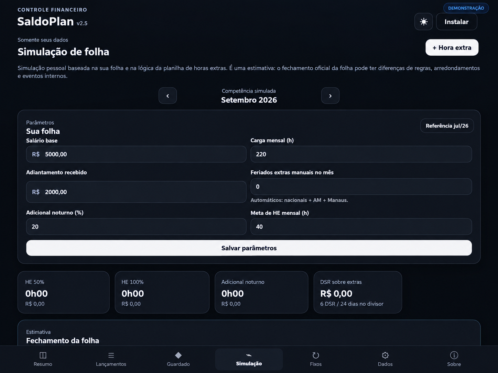

> **SaldoPlan v5.1.3 — Auto Boot protegido:** corrige a primeira conexao de perfis novos quando as telas criam automaticamente registros padrao de folha, 13o, FGTS ou patrimonio. O aplicativo so conecta sem clique se os valores corresponderem estritamente aos defaults; dados financeiros reais ou exclusivos continuam exigindo decisao. Preserva backups e dados locais. Veja `LIVE-SYNC-SETUP.md`.

> **SaldoPlan v5.1.2 — Auto Link seguro:** o login Google agora também vincula automaticamente um aparelho cujos registros locais já estejam representados integralmente e sem divergências na nuvem. Perfis novos continuam automáticos; dados exclusivos ou divergentes exigem escolha antes de recuperar. Nunca apaga dados divergentes automaticamente. Veja `LIVE-SYNC-SETUP.md`.

> **SaldoPlan v5.1.1 — Auto Sync:** ao entrar com Google em um aparelho novo e sem dados financeiros próprios, a conta recupera automaticamente o histórico sincronizado pelo Firestore. Perfis com informações locais diferentes continuam exigindo escolha explícita; backup Drive/JSON permanece separado. Consulte `LIVE-SYNC-SETUP.md`.

<div align="center">


# SaldoPlan

**Sua vida financeira, organizada em um só lugar.**

[](https://saldoplan.vercel.app/) [](https://saldoplan.vercel.app/) [](https://developer.mozilla.org/docs/Web/JavaScript) [](https://firebase.google.com/)

[**Abrir SaldoPlan**](https://saldoplan.vercel.app/) · [**Sobre o projeto**](https://joeyrickson-portfolio.vercel.app/) · [**Reportar problema**](https://github.com/JoeyRickson/PWA_CAIXA/issues)

</div>

---

## O que é?

O **SaldoPlan** é um aplicativo de controle financeiro pessoal desenvolvido como **Progressive Web App (PWA)**, com experiência responsiva para celular e desktop e suporte a uso offline. Você pode registrar receitas e despesas, planejar gastos, acompanhar cartões e patrimônio e consultar seus dados sem depender continuamente da internet.

**Tecnologias:** HTML5, CSS3, JavaScript puro, Service Worker, Web Crypto, Firebase Authentication, Firestore opcional, Vercel Serverless Functions e integrações de backup. O frontend **não usa React, Vue ou outro framework**.

## Recursos

| Área | Funcionalidades |
| --- | --- |
| **Resumo** | Saldos atuais e projetados, visão mensal, ciclos e calendário financeiro |
| **Lançamentos** | Receitas, gastos, pagamentos previstos ou realizados, recorrências e lançamentos rápidos no celular |
| **Cartões** | Limites, fechamento, vencimento, faturas e parcelamentos |
| **Guardado e patrimônio** | Reservas, metas, dívidas, investimentos e evolução patrimonial |
| **Planejamento** | Orçamento por categoria, indicadores de gastos, pesquisa e relatório anual |
| **Simuladores** | Folha salarial, horas extras, adicionais, 13º salário e FGTS |
| **Importação** | CSV, OFX/QFX e PDFs compatíveis, prévia com seleção, regras de categorização e avisos de possíveis duplicados |
| **Backups** | JSON manual, histórico local, Google Drive e outros provedores conforme configuração, cópia criptografada entre aparelhos |
| **Perfis por conta** | Dados locais em espaços separados por conta Google após associação explícita dos dados antigos |
| **Notificações** | Avisos com app aberto e lembretes push opt-in com escolha de antecedência (dependem de Firebase/Vercel e permissão) |
| **Suporte** | Formulário autenticado, protocolo por e-mail e central administrativa opcional com controle de acesso no servidor |

| **Novidades v5** | Assistente financeiro local por regras, aportes às metas manuais, exportação do fechamento mensal, preferências push e testes de regressão |

### Algumas telas

<div align="center">
  
  
  
  
</div>

## Privacidade e armazenamento

- Os lançamentos ficam **no armazenamento do navegador**. Uma conta Google **não transforma automaticamente os dados em um banco remoto**.
- Na v4, **cada conta Google possui um espaço local separado**. Ao associar os dados legados pela primeira vez, o usuário pode copiá-los para a conta ou iniciar um perfil vazio; a base antiga permanece no navegador. **Faça um backup JSON antes de começar.**
- A separação local é uma medida de organização, **não uma proteção criptográfica contra pessoas com acesso ao mesmo perfil do navegador ou dispositivo**. Para dados sensíveis, proteja o dispositivo e a conta do sistema operacional.
- A cópia opcional entre aparelhos usa um documento por UID no Firestore, cifrado no navegador com **AES-GCM / PBKDF2-SHA256**, usando senha de proteção própria (mínimo 8 caracteres; senha longa recomendada).
- A sincronização é de **snapshots completos**: não mescla lançamentos editados simultaneamente em aparelhos diferentes. Os conflitos interrompem o envio automático e exigem escolha explícita.
- A senha de proteção pode ser lembrada **opcionalmente por aparelho**. Não equivale a biometria ou a um cofre de hardware.
- Google Drive e outros serviços de nuvem têm autorizações **separadas** do login Firebase. As funções disponíveis variam por provedor.

> **Evite perda de dados:** exporte um backup JSON antes de trocar de aparelho, conta ou versão. Não limpe o armazenamento do navegador nem desinstale o PWA sem preservar os arquivos.

## Instalação e uso

**Versão hospedada:** https://saldoplan.vercel.app/

No Android, abra no Chrome e use **Instalar aplicativo / Adicionar à tela inicial**. No computador, use o comando de instalação oferecido pelo navegador. O funcionamento offline depende de os arquivos terem sido carregados anteriormente.

Para executar localmente:

```bash
# Na pasta do repositório
npm install
npx vercel dev
```

Ou para inspecionar apenas a interface estática:

```bash
python -m http.server 3000
```

Abra `http://localhost:3000`. **Atenção:** funções `/api/*` requerem Vercel Dev ou deploy compatível; o servidor HTTP simples não executa as funções serverless. O login e as integrações externas exigem origens autorizadas e configurações próprias.

## Organização do código

```text
index.html              Entrada da PWA
app.js                  Bootstrap de telas e scripts
js/core.js              Estado financeiro, migração e salvamento
js/                    Lançamentos, cartões, calendário, importação, etc.
js/v4-features.js       Perfis por conta, atalhos e diagnóstico
js/v4-push.js           Ativação opt-in das notificações em segundo plano
views/                  Páginas parciais HTML
css/                    Estilos por funcionalidade e temas
api/                    Funções serverless de suporte e push
sw.js                   Cache offline e receptor de push
firebase-config.js      Configuração pública do Firebase
push-config.js          Chave VAPID pública (vazia até configurar)
ARQUITETURA.md          Detalhes técnicos e contratos de dados
FIRESTORE-SETUP.md      Regras e limites da cópia criptografada
PUSH-SETUP.md           Ativação e limites das notificações push
V5-SETUP.md             Permissões administrativas e checklist de homologação
js/v5-engine.js         Cálculos determinísticos do assistente local
js/v5-features.js       Interface de metas, PDF, perguntas e push
js/v5-admin.js          Interface administrativa (API valida o UID)
api/support-admin.js    API administrativa protegida
CHANGELOG.md            Histórico de versões
```

### Variáveis e serviços externos

| Variável | Para que serve |
| --- | --- |
| `FIREBASE_PROJECT_ID` | Validação de login no backend de suporte |
| `RESEND_API_KEY` | Envio de solicitações para o desenvolvedor |
| `SUPPORT_FROM_EMAIL` | Remetente autorizado no Resend |
| `FIREBASE_SERVICE_ACCOUNT_JSON` | Credencial **secreta** do backend push/Firestore Admin |
| `CRON_SECRET` | Proteção da rotina agendada para enviar push |
| `SUPPORT_ADMIN_UID` | UID Firebase autorizado a administrar solicitações no backend |
| `push-config.js` → `vapidPublicKey` | Chave **pública** Web Push do Firebase |

Os serviços opcionais só funcionam depois de configurados. **Jamais coloque segredos em arquivos `.js` do frontend, GitHub ou commits.** `.env.local`, `node_modules/` e `.vercel/` devem permanecer fora do controle de versão.

### Verificações antes de publicar

```powershell
node --check .\app.js
node --check .\auth.js
Get-ChildItem .\js\*.js | ForEach-Object { node --check $_.FullName }
Get-ChildItem .\api\*.js | ForEach-Object { node --check $_.FullName }
npm.cmd audit --omit=dev
git diff --check
git status --short
```

No caso de atualizações incrementais, guarde um backup, teste no computador e no Android e confirme o resultado antes de publicar.

## Roadmap e limitações

- A sincronização entre aparelhos **ainda não faz mesclagem automática** de edições concorrentes.
- Push com a PWA fechada **exige habilitar Firebase Cloud Messaging e backend**, descritos em [`PUSH-SETUP.md`](PUSH-SETUP.md). Disponibilidade depende do navegador, permissões e conectividade.
- O leitor PDF só reconhece formatos compatíveis; todos os itens importados devem ser revisados pelo usuário.
- Perfis separados no **mesmo navegador** não são contas protegidas por senha local ou isolamento de sistema operacional.
- O app não acessa contas bancárias automaticamente e não é um serviço de aconselhamento financeiro.

## Autor

Desenvolvido e mantido por **Joey Rickson**.

[GitHub](https://github.com/JoeyRickson) · [LinkedIn](https://linkedin.com/in/joeyrickgoliveira) · [Portfólio](https://joeyrickson-portfolio.vercel.app/)

---

*SaldoPlan é um projeto independente de controle financeiro pessoal.*

## SaldoPlan v5.0.0 — Recursos integrados

O assistente financeiro é **local e baseado em regras**; não utiliza modelo externo nem envia lançamentos para serviços de IA. O painel administrativo só funciona com `SUPPORT_ADMIN_UID` e credencial de serviço Firebase configurados. O backup e as permissões continuam independentes do login. Consulte [`V5-SETUP.md`](V5-SETUP.md).


### Compatibilidade da v5 consolidada

Esta versão mantém a correção da v4 que permite lançamentos únicos com datas futuras,
sem confundir esses lançamentos com recorrências. Backups continuam independentes dos perfis locais.
Antes de migrar, exporte os dados pelo aplicativo e faça os testes descritos em `V5-SETUP.md`.


## 🔄 Sincronização automática entre dispositivos — v5.1.0

O **Live Sync** permite que a mesma conta Google mantenha lançamentos, cartões, metas e outros registros alinhados entre celular e computador. Ao criar, editar ou excluir um registro, o SaldoPlan guarda a alteração localmente e a transmite ao Firestore; aparelhos conectados recebem os eventos em tempo real. Se não houver internet, uma fila local aguarda a reconexão.

**Primeira ativação:** em **Dados e backup → Backups → Entre aparelhos**, escolha se deseja usar os dados deste aparelho, recuperar os dados já existentes na nuvem ou unir registros sem sobrescrever. É preciso fazer essa escolha uma única vez por aparelho/conta, para evitar misturar históricos diferentes. Exporte antes um backup JSON independente. Depois de vincular, as próximas sessões autenticadas sincronizam automaticamente.

**Conflitos:** alterações simultâneas no mesmo registro não são sobrescritas silenciosamente. O aplicativo pausa esse registro e permite selecionar a versão a manter. Outras alterações podem continuar sincronizando. Os registros excluídos são representados como marcações de exclusão (tombstones).

**Privacidade:** este modo é vinculado ao UID do Firebase Authentication, usa HTTPS, regras privadas do Firestore e criptografia da infraestrutura Firebase em repouso. **Não é criptografia ponta a ponta:** administradores autorizados do projeto Firebase podem tecnicamente ler registros sincronizados. Para manter uma cópia protegida por senha própria, use o **Backup entre aparelhos** criptografado, que permanece separado, ou exporte o backup local.

**Configuração:** veja [LIVE-SYNC-SETUP.md](LIVE-SYNC-SETUP.md) para instalar as regras sem remover as coleções existentes. O Live Sync é opcional e não impede o uso offline nem substitui o backup de segurança. Pode gerar consumo de leituras, gravações e armazenamento no Firestore.
